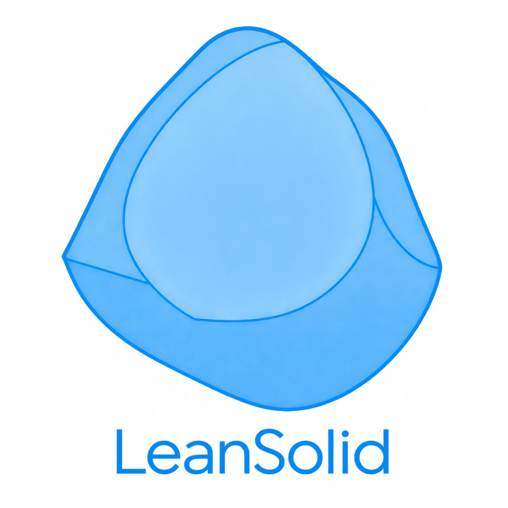

<table>
  <tr>
    <td valign="top"></td>
    <td valign="top">LeanSolid is a pre-alpha project for formalizing solid mechanics in Lean 4 with Mathlib. It aims to make modeling assumptions explicit, express constitutive laws as reusable definitions, verify derivations, and support AI-assisted reasoning with Lean as the proof checker.</td>
  </tr>
</table>

## Project metrics

| Metric | Current | How it is counted |
| :--- | :--- | :--- |
| **Lean Declarations** | **<!-- metric:declarations -->1,791<!-- /metric:declarations -->** | Named declarations with source ranges from library modules loaded by `import LeanSolid`, including definitions, theorems, structures and classes. |
| **Verified Theorems** | **<!-- metric:verified -->1,285 / 1,285<!-- /metric:verified -->** | Verified / total named library theorems and lemmas. Lean checks transitive axiom dependencies against `propext`, `Classical.choice` and `Quot.sound`. |
| **Formalized Papers** | **<!-- metric:papers -->0 complete · 4 partial<!-- /metric:papers -->** | Coverage of papers and memoirs recorded in [Landmark Results](LandmarkResults/). Standalone [research companions](ResearchCompanions/) have separate verification records. |
| **Landmark Results** | **<!-- metric:landmarks -->4<!-- /metric:landmarks -->** | Classical results registered with a Lean proof in the [Landmark Results index](LandmarkResults/). |
| **Lines of Lean** | **<!-- metric:lines -->18,100<!-- /metric:lines -->** | Lines containing code in `LeanSolid.lean` and `LeanSolid/**/*.lean`. |
| **Build Status** | [](https://github.com/AI4Solid/LeanSolid/actions/workflows/ci.yml) | GitHub Actions runs `lake build` on the default branch. |
| **Open Problems** | **<!-- metric:problems -->5<!-- /metric:problems -->** | Registered questions in the [OpenProblems Registry](https://ai4solid.github.io/LeanSolid/OpenProblems/), including entries with partial progress. |

To refresh both tables, run `lake build` and then `python scripts/update_metrics.py` from the repository root.

## Implemented

- `LeanSolid.Constitutive.Uniaxial` defines scalar Hooke's law and quadratic elastic strain energy density. It proves the half-stress-times-strain identity and energy nonnegativity under a nonnegative Young's modulus.
- `LeanSolid.Examples.Uniaxial` proves that stress determines strain uniquely when Young's modulus is strictly positive.
- `LeanSolid.Math` provides Cartesian tensor definitions and algebraic properties.
- `LeanSolid.ContinuumMechanics` provides finite-deformation kinematics and reference-configuration statics. It verifies the deformation-gradient chain rule, stress and traction transformations, and the exact link from Green–Lagrange strain to infinitesimal strain. Its teaching alignment draws on Brown University's **ENGN 2210 · Continuum Mechanics** lecture notes.
- Its rate kinematics provides the material deformation-gradient rate, spatial velocity gradient, rate of deformation, spin, and their transformation under a rotating observer.
- Its hyperelasticity modules provide the principal invariants, energy-derived stress, and checked Saint Venant–Kirchhoff and compressible logarithmic neo-Hookean stress formulas.
- `LeanSolid.LinearElasticity` separates small-strain isotropic elasticity definitions, theorems and corollaries. Its teaching alignment draws on Brown University's **ENGN 2240 · Linear Elasticity** lecture notes.
- Its fourth-order stiffness modules cover the minor and major symmetries, engineering Voigt reduction, orthotropic and cubic forms, and sharp cubic and Lamé energy-positivity conditions.
- `LeanSolid.Elastostatics` proves weak existence and uniqueness under explicit coercivity and verifies that condition for a bounded clamped Sobolev model with μ > 0 and λ + μ ≥ 0.

See the [handoff](HANDOFF.md) for scope and progress and the [changelog](CHANGELOG.md) for recent updates. [ResearchCompanions](ResearchCompanions/) collects standalone Lean applications accompanying research in theoretical solid mechanics. Each companion has its own verification instructions and is outside the default `import LeanSolid` entry point.

Both courses are part of Brown's solid mechanics teaching and were taught by Huajian Gao. The alignments map selected lecture topics to Lean definitions, theorems, and their assumptions. Contributors can add other teaching materials, check their derivations against existing proofs where the assumptions match, and record missing results for future formalization.

## Importing the library

For classical results and the Lean declarations that prove them, see [LandmarkResults](LandmarkResults/).

For research questions and their source literature, see [Formalization of Open Problems in Solid Mechanics](OpenProblem/).

- `import LeanSolid.ContinuumMechanics` for the deformation gradient, Cauchy–Green tensors, Green–Lagrange strain, Piola stresses, and strong static balance.
- `import LeanSolid.LinearElasticity` for small-strain kinematics, constitutive laws, compatibility, and Voigt notation.
- `import LeanSolid.Elastostatics` for weak equilibrium, energy principles, Galerkin estimates, and supported boundary-value models.
- `import LeanSolid` for all project modules and the examples.

## Build

Install [Elan](https://github.com/leanprover/elan), then run these commands from the repository root.

```sh
lake exe cache get
lake build
```

The Lean toolchain and Mathlib revision are pinned. The build treats project warnings as errors, including warnings for unfinished proofs.

## Roadmap

The v0.1 target is December 9, 2026. The initial milestone is a reproducible build and a small set of documented, checked linear-elastic examples. The broader roadmap covers the following areas.

- **Linear elasticity.** Extend the clamped model to mixed and pure-traction Sobolev boundary-value problems and add checked applications.
- **Fracture.** Formalize energy release and selected Griffith-type derivations.
- **Interfaces.** Specify traction–separation laws and assumptions behind interface conditions.
- **Instability.** Work through energy-based stability and elementary bifurcation examples.

## Related work

Thanks to the [lean-mechanics contributors](https://github.com/raphos-com/lean-mechanics). Their Lean 4 and Mathlib library spans classical, continuum, and discrete mechanics, including constitutive theory, fracture, contact, and stability. LeanSolid starts with small constitutive examples and focuses on expressing assumptions and checking individual derivations, including those developed with AI assistance.

The continuum comparison records the shared results, differences, and source revisions for the imported modules. [Continuum mechanics comparison](docs/CONTINUUM_MECHANICS_UPSTREAM.md)

## Maintainer

Created and maintained by Siyuan Song ([@ssong26](https://github.com/ssong26)), a postdoctoral researcher in solid mechanics at Brown University.

Interested in collaborating on formalizing solid mechanics in Lean? Feel free to [open a GitHub issue](https://github.com/ssong26/LeanSolid/issues).

## License

[Apache-2.0](LICENSE).
